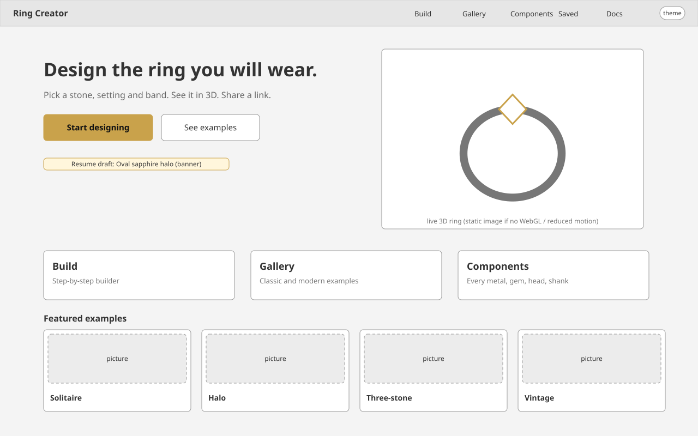
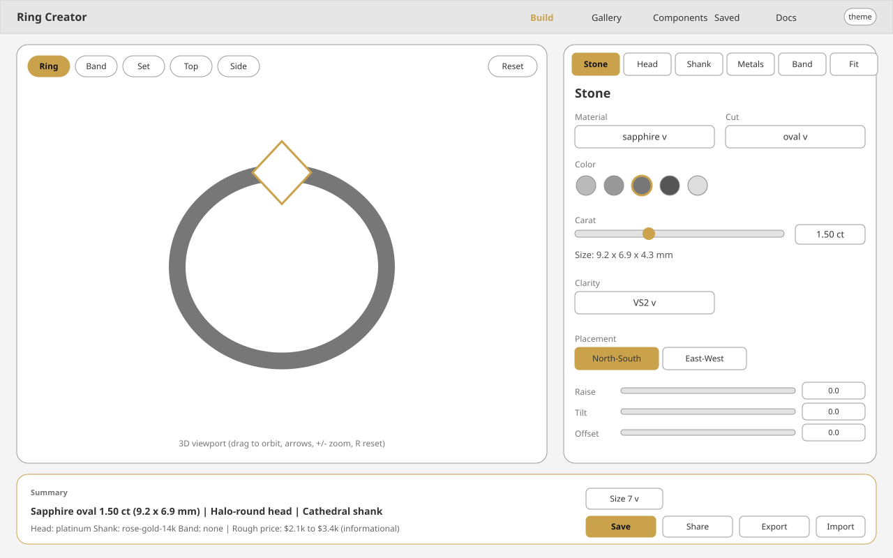
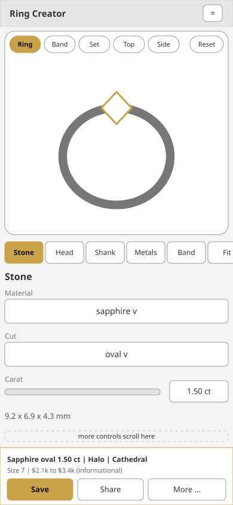
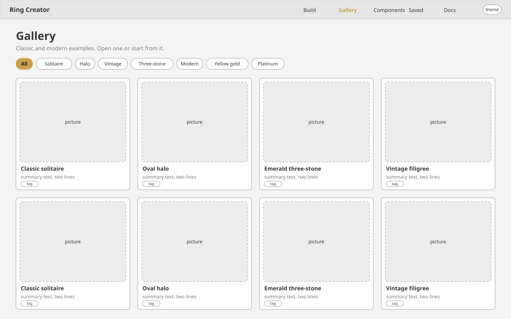
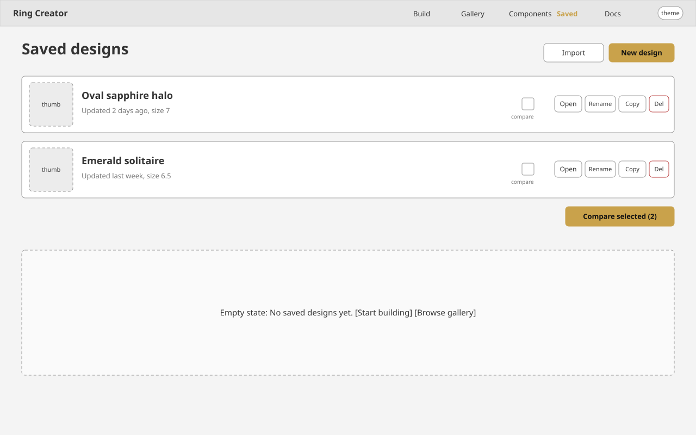
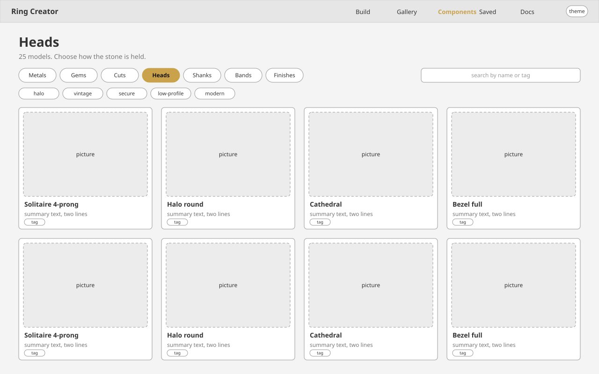
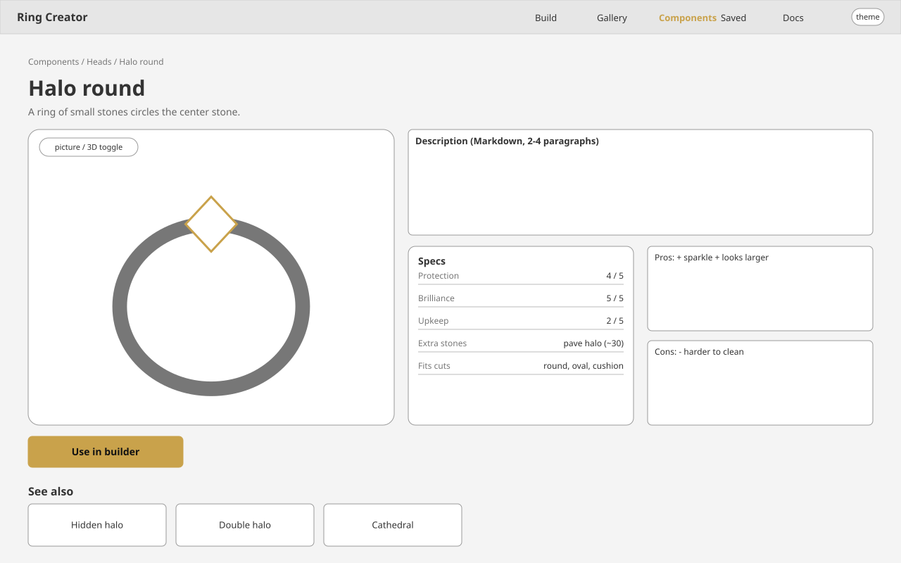
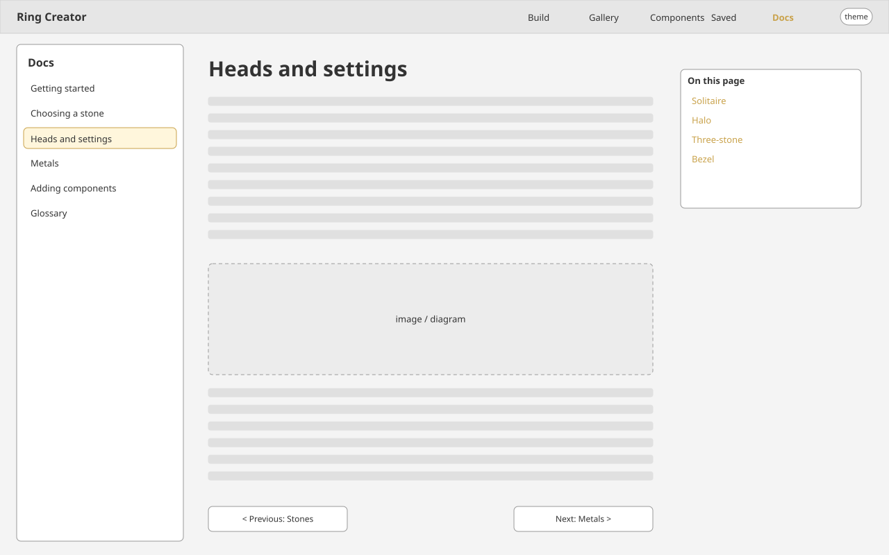
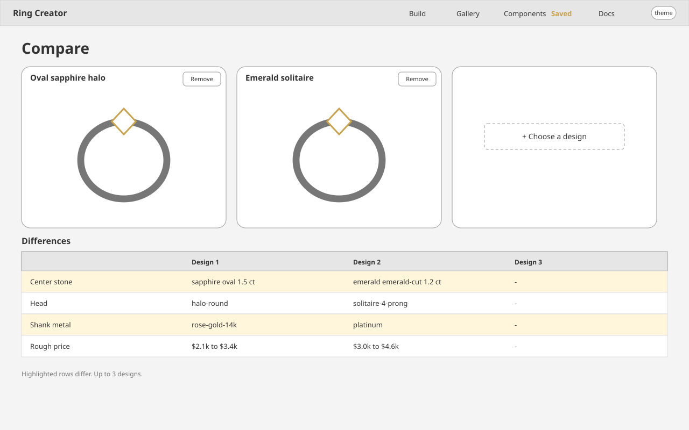

# Wireframes

Low-fidelity layouts: greyscale with one gold accent for the primary action and the current selection. Desktop frames are 1280x800, mobile 390x844. They show structure, not final styling; tokens are in [design-system.md](../design/design-system.md) and routes in [information-architecture.md](../specs/information-architecture.md).

## Home

Left of the hero is the message and the single gold action ("Start designing"), the live ring sits on the right so the product is visible without scrolling. A resume banner appears only if a draft exists. Three tiles route to the main areas, and four featured examples give a quick taste.

## Builder (desktop)

The 3D viewport takes the left 60% and stays put while the controls scroll on the right. View buttons (Ring / Band / Set / Top / Side) and Reset overlay the viewport. Step tabs (Stone | Head | Shank | Metals | Band | Fit) follow the natural order of decisions; the Stone step is shown with material, cut, color swatches, carat with millimetres, clarity and placement sliders. The sticky bottom bar keeps the spec summary, rough price, ring-size select and Save / Share / Export / Import always reachable.

## Builder (mobile)

On a phone the viewport is on top (about 45% of the screen), the step tabs scroll horizontally, and controls fill the rest. The summary bar is fixed at the bottom with Save and Share; Export and Import move into a "More" menu to keep targets at least 44 px.

## Gallery

Filter chips narrow by style, metal and stone. Each card shows a generated picture, name and tags; opening one leads to the detail page with "Start from this".

## Saved designs

Each row has a thumbnail, name, last update, and the actions Open / Rename / Copy / Delete, plus a checkbox to pick designs for Compare. The empty state (dashed box) points to the builder and gallery.

## Component list

Kind tabs switch between metals, gems, cuts, heads, shanks, bands and finishes. Search and tag chips filter the grid of component cards, which show a picture, summary and tags.

## Component detail

The large picture (or 3D toggle) is paired with the gold "Use in builder" action. The right side reads top to bottom: description, spec table with ratings, then pros and cons. "See also" links to related models.

## Docs

A sidebar lists guides, the center renders Markdown with previous/next links, and an on-page table of contents sits on the right for long pages.

## Compare

Up to three designs are shown side by side in synced 3D views. The table below highlights only the rows that differ so the decision comes down to a few facts.
